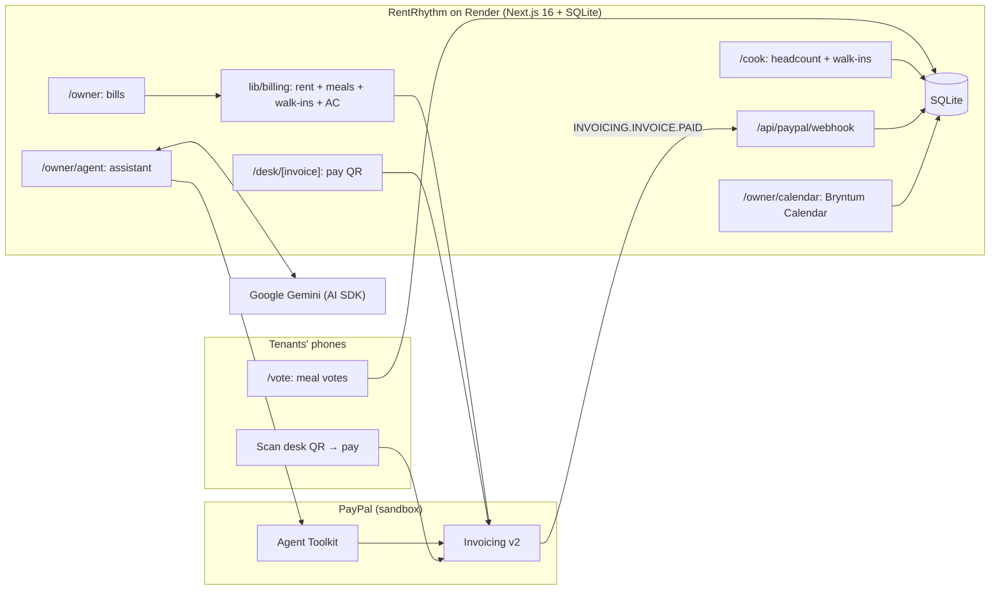

# RentRhythm

**Rent that follows payday. Meals that follow votes.**

RentRhythm is a management app for co-living spaces, hostels and student housing. It bills every tenant on
**their own payday** with **one PayPal invoice** a month, rewards tenants for **voting on tomorrow's meals**, and
gives the owner an **AI collections assistant** that reminds only the tenants who should already have the money.

Built for the [PayPal AI Hackathon](https://paypalaihackathon.devpost.com/).

- **Live demo:** https://rentrhythm.onrender.com (PayPal **sandbox**; the free server sleeps when idle, so the
  first page can take up to a minute to load)
- **Demo video:** _link added at submission_
- **License:** [MIT](LICENSE)

## The problem

In a meeting with paying-guest (PG) accommodation owners in India, two problems came up again and again:

- **Rent arrives whenever salaries do.** Owners give everyone until the 15th and still chase people all month,
  because each tenant is paid on a different day. Rent was their biggest concern.
- **Meals are cooked blind.** Most tenants don't say whether they'll eat lunch or dinner tomorrow. Non-voters eat
  anyway, food runs out for the people who did vote, and the cook has to cook again.

These problems aren't specific to India: any shared housing with varied tenant incomes and a shared kitchen has
them. RentRhythm targets co-living, hostels and student housing anywhere PayPal Invoicing is available.

## What it does

| | Feature | Where |
|---|---|---|
| 📅 | **Payday-synced due dates.** Each bill is due on the tenant's own payday the following month, plus grace days. A Bryntum calendar shows every due date, coloured paid / not due / payday passed / overdue, and flags repeat late payers. | `/owner/calendar` |
| 🧾 | **One smart monthly PayPal invoice** per tenant: rent + meals voted for + walk-in meals + utility (AC) share. Sent through PayPal Invoicing v2; the status turns **PAID live** via PayPal's `INVOICING.INVOICE.PAID` webhook. | `/owner` |
| 🍽 | **Meal voting with an incentive.** Tenants vote Lunch ✅/❌ and Dinner ✅/❌ for tomorrow on their phone (until 9 PM). Voted meals cost $3; eating without voting is a $5 walk-in. | `/vote` |
| 👩‍🍳 | **Kitchen view.** Tomorrow's headcount and who hasn't voted; today's serving log, where the cook unticks no-shows and adds walk-ins (which land on that tenant's bill). | `/cook` |
| 🤖 | **AI collections assistant.** Ask *"Who's due this week? Remind anyone whose payday has passed."* It checks paydays and PayPal invoices, sends PayPal reminders only to tenants whose payday has passed, skips the rest with the reason, and flags repeat late payers. Every tool call is shown. | `/owner/agent` |
| 📱 | **Pay at the desk.** A full-screen PayPal QR for any unpaid bill; the tenant scans and pays on their phone, and the screen flips to "Paid" when the webhook lands. | `/owner` → **Show pay QR** |

## AI tools and models used

**In the product**

- **Google Gemini (`gemini-3.6-flash`)**, called through the **Vercel AI SDK** (`ai` 7 + `@ai-sdk/google`), powers
  the collections assistant. It plans multi-step tool use (look up, decide, act), writes the short, polite reminder
  notes, and summarises what it did for the owner.
- **PayPal Agent Toolkit** (`@paypal/agent-toolkit` 1.11.0) gives the model PayPal Invoicing tools. The assistant is
  limited to four of them: **list invoices, get invoice, send invoice reminder, generate invoice QR code**. No
  money-moving tools (payouts, refunds, captures) are enabled. The toolkit was built for AI SDK v4, so
  `lib/agent.ts` re-wraps each tool for AI SDK v7 and logs every call; it is pinned to the sandbox.
- **One read-only tool over the app's own data**, `get_collections_overview`, gives the model each tenant's payday,
  latest invoice, payment history and a plain-language status computed in code. Deterministic code works out who
  is due, overdue or a repeat late payer (late in 2 of the last 3 months); the model decides how to act and how to
  word it, and quotes the computed facts instead of re-deriving dates and amounts.
- **Guardrails:** a reminder is sent only for an invoice RentRhythm itself sent and that PayPal still shows as
  unpaid; calls have a timeout; Gemini rate limits and the free tier's daily cap produce a friendly message
  instead of a hang.

**In building it**

- The app was written with **Claude Code** (Anthropic) as a pair programmer: scaffolding, PayPal and Gemini
  integration, tests, debugging (e.g. the webhook signature check and the Bryntum bundling issue) and these docs,
  reviewed and steered step by step.

## Architecture



- **Billing** (`lib/billing.ts`) and **collections** (`lib/collections.ts`) are pure, unit-tested functions.
- **Sending is idempotent** per tenant and month; the webhook is **signature-verified** with PayPal, re-reads the
  invoice from PayPal's API rather than trusting the payload, and applies each event once.
- **Hosting:** Render's free tier wipes the disk when the server sleeps, so on start the app reseeds demo data and
  **rebuilds its real invoice records from PayPal** (our invoice numbers encode the month and tenant).
- **Bryntum Calendar** is loaded at runtime from `public/vendor/bryntum` instead of being bundled: its 5 MB trial
  build made the bundler run out of memory.

## Try it (judges)

Open https://rentrhythm.onrender.com and follow **Start here** on the home page. The data is a demo property,
"Sunrise Co-Living", with six tenants and a few months of history. Things to try:

1. **Calendar:** click a bill to see its payday, due date and status; Daniel is a repeat late payer.
2. **Meal vote** on a phone, then watch **Kitchen** update within seconds.
3. **Bills:** "Preview bill" shows the line items; unpaid bills have **Show pay QR**.
4. **Assistant:** tap *"Who's due this week? Remind anyone whose payday has passed."*

Notes: it's PayPal's sandbox, so reminders go to a sandbox inbox and no real money moves. Paying needs a PayPal
**sandbox buyer** login. The assistant runs on Gemini's free tier; if today's quota is used up it says so and
everything else keeps working.

## Run it locally

Requirements: Node.js 22, a [PayPal developer](https://developer.paypal.com/) account (sandbox), and a
[Google AI Studio](https://aistudio.google.com/) API key.

```bash
npm install
cp .env.example .env      # then fill it in (see below)
npm run seed              # demo data in data/rentrhythm.db
npm run dev               # http://localhost:3000
npm test                  # unit tests (billing, meals, collections, calendar, webhook)
```

`.env`:

| Variable | What |
|---|---|
| `PAYPAL_CLIENT_ID`, `PAYPAL_CLIENT_SECRET` | Sandbox REST app credentials (Apps & Credentials, Sandbox). Invoices are sent from the business account that owns this app. |
| `PAYPAL_BUYER_EMAIL` | A sandbox **personal** account created with **country = United States**; all demo tenants use it. |
| `PAYPAL_BUSINESS_EMAIL` | Informational only. |
| `PAYPAL_WEBHOOK_ID` | From `npm run register-webhook -- https://<your-host>/api/paypal/webhook` (needs a public HTTPS URL). |
| `GOOGLE_GENERATIVE_AI_API_KEY` | Gemini API key. |
| `GEMINI_MODEL` | Defaults to `gemini-3.6-flash`. |
| `DEMO_TODAY` | Optional `YYYY-MM-DD` to pin "today" for the calendar and assistant (rehearsals). |

Useful scripts: `npm run send-invoice -- <tenantId> <YYYY-MM>`, `npm run agent -- "<request>"`,
`npm run smoke:invoice`.

**Sandbox gotchas we hit** (details in [`CLAUDE.md`](CLAUDE.md)):

- Sending invoices to an **India-registered** sandbox buyer fails (`INR_FOREIGN_CURRENCY_BLOCKED`); use a US one.
- Don't set `invoicer.email_address`; a mismatch with the API account fails with `USER_NOT_FOUND`.
- The Agent Toolkit defaults to **production** unless `context: { sandbox: true }` is set.
- PayPal's invoice QR is at most 500 px and arrives as a multipart body wrapping a base64 PNG.

### Deploying on Render (free)

Web service, Node 22. Build: `npm ci --include=dev && npm run build`. Start: `npm run start:render`. Set the
environment variables above in Render's dashboard, then register the webhook for
`https://<service>.onrender.com/api/paypal/webhook`.

## Limitations

- **Sandbox only:** no real payments; one sandbox buyer stands in for every tenant.
- **No logins:** tenants pick their name, and owner pages are open (it's a demo).
- **Free hosting:** the server sleeps after 15 idle minutes and wakes with fresh demo data (real invoices are
  restored from PayPal; votes and walk-ins entered on the live site are not kept).
- **Gemini free tier:** a small daily request cap; the assistant tells you when it's reached.
- **Bryntum Calendar trial:** shows a faint "Trial Version" watermark.
- One property, USD, lunch and dinner only.

## Project structure

```
app/            Next.js pages: /owner, /owner/calendar, /owner/agent, /cook, /vote, /desk, API routes
lib/            billing, meals, collections, calendar (pure + tests), paypal, agent, payments (webhook), db
scripts/        seed, send-invoice, agent, register-webhook, smoke-invoice, copy-bryntum
drizzle/        SQLite migrations
docs/           demo-runbook.md (recording-day steps)
```
